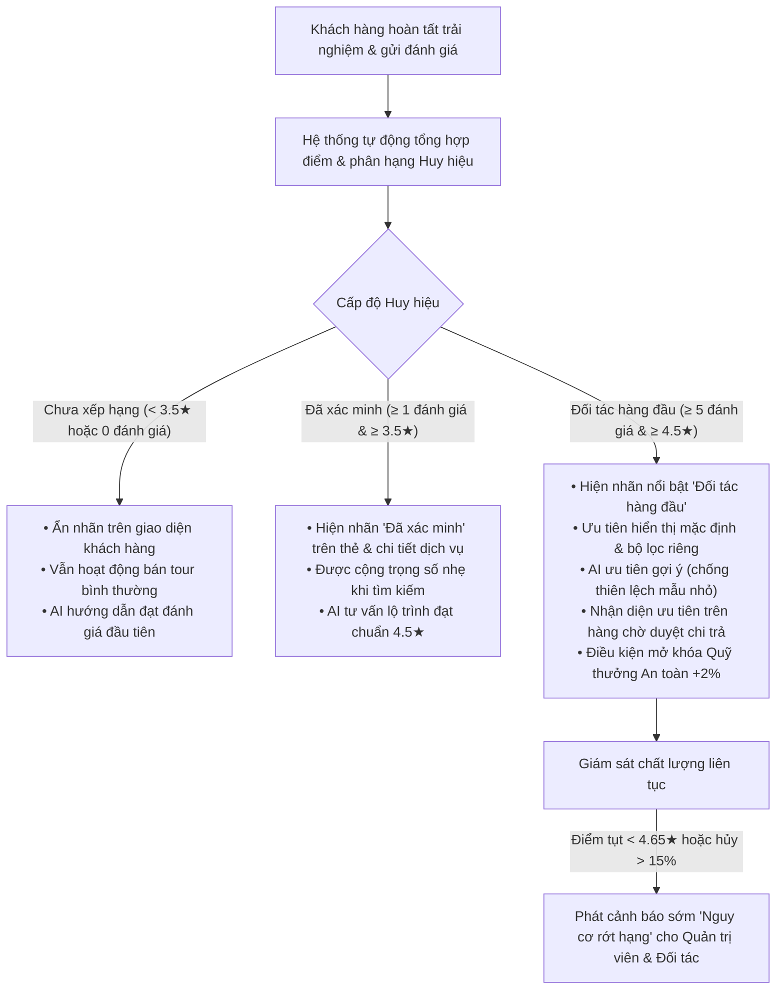

# Hệ thống Huy hiệu Uy tín Đối tác (`BadgeTier`)

---

## 1. Tổng quan & Mục tiêu nghiệp vụ

Trong nền tảng trải nghiệm du lịch biển **DANASEA**, đặc thù các dịch vụ thể thao mặt nước (lặn ngắm san hô, chèo SUP, cano dù bay, mô tô nước, câu mực đêm...) đòi hỏi mức độ tin cậy và an toàn rất cao từ phía khách hàng. Hệ thống **Huy hiệu Uy tín Đối tác (`BadgeTier`)** được thiết kế nhằm:

- **Tạo tín hiệu niềm tin minh bạch cho khách hàng:** Giúp du khách nhanh chóng nhận diện các đơn vị tổ chức đã được cộng đồng kiểm chứng chất lượng, giảm bớt lo ngại khi đặt trải nghiệm biển trực tuyến.
- **Tạo động lực nâng cao chất lượng dịch vụ cho đối tác:** Chuyển hóa uy tín phục vụ thành lợi ích thực tế về lưu lượng hiển thị, tốc độ hỗ trợ vận hành và cơ hội nhận thưởng tài chính từ sàn.
- **Hỗ trợ ban quản trị giám sát sức khỏe chất lượng toàn sàn:** Cung cấp bức tranh phân tầng chất lượng đối tác và cảnh báo sớm khi các đơn vị chủ lực có dấu hiệu suy giảm dịch vụ.

---

## 2. Nguyên tắc thiết kế cốt lõi: Tách biệt Pháp lý và Uy tín

Hệ thống DANASEA phân tách rạch ròi giữa **điều kiện pháp lý để hoạt động** và **cấp độ uy tín thương mại**:

1. **Xác minh pháp lý (`VerificationStatus`):** Kiểm soát quyền được phép mở bán dịch vụ trên sàn thông qua việc thẩm định Giấy phép đăng ký kinh doanh và Chứng nhận an toàn giao thông đường thủy. Đây là trách nhiệm xét duyệt trực tiếp của Quản trị viên.
2. **Huy hiệu uy tín (`BadgeTier`):** Phản ánh chất lượng phục vụ thực tế mà khách hàng trải nghiệm và đánh giá sau khi hoàn tất chuyến đi.
   - Huy hiệu được hệ thống **tính toán và cập nhật tự động 100%** dựa trên dữ liệu đánh giá hợp lệ.
   - Quản trị viên **không gán hay chỉnh sửa huy hiệu thủ công** khi duyệt hồ sơ đối tác nhằm đảm bảo tính khách quan, công bằng và loại bỏ nguy cơ thiên vị.

---

## 3. Phân hạng Huy hiệu & Cơ chế tính toán tự động

Hệ thống vận hành thống nhất theo đúng **3 cấp độ huy hiệu** trên toàn bộ nền tảng:

| Cấp độ | Tên hiển thị | Tiêu chí đạt được | Ý nghĩa nghiệp vụ |
| :--- | :--- | :--- | :--- |
| **`NONE`** | **Chưa xếp hạng** | Chưa có đánh giá hợp lệ nào (`0` đánh giá) **hoặc** điểm trung bình `< 3.50 / 5.0` | Đối tác mới gia nhập sàn chưa có đủ phản hồi thực tế, hoặc chất lượng dịch vụ chưa đạt ngưỡng tối thiểu để gắn nhãn uy tín. |
| **`VERIFIED`** | **Đã xác minh** | Có ít nhất **1 đánh giá** hiển thị **và** điểm trung bình `≥ 3.50 / 5.0` *(nhưng chưa đủ chuẩn Đối tác hàng đầu)* | Đối tác đã phục vụ khách thực tế và nhận được phản hồi đạt chuẩn chất lượng cơ bản. |
| **`TOP_RATED`** | **Đối tác hàng đầu** | Có ít nhất **5 đánh giá** hiển thị **và** điểm trung bình `≥ 4.50 / 5.0` | Đối tác có năng lực vận hành ổn định, được đông đảo khách hàng đánh giá xuất sắc và hưởng trọn vẹn các đặc quyền uy tín của sàn. |

### Cơ chế cập nhật & Bảo toàn tính chính xác
- **Cập nhật theo thời gian thực:** Ngay khi khách hàng gửi đánh giá mới sau chuyến đi hoàn tất, chỉnh sửa đánh giá, hoặc khi Quản trị viên ẩn/khôi phục một đánh giá vi phạm chính sách, hệ thống tự động tính lại tổng số lượt đánh giá hiển thị, điểm trung bình và cập nhật ngay cấp độ huy hiệu tương ứng (có thể thăng hạng hoặc hạ hạng ngay lập tức).
- **Chỉ tính trên đánh giá hợp lệ và hiển thị:** Các đánh giá đã bị ẩn do kiểm duyệt vi phạm hoàn toàn không được đưa vào công thức tính điểm và xét huy hiệu.
- **Kiểm soát đồng thời (Concurrency Control):** Khi nhiều khách hàng cùng đánh giá hoặc quản trị viên kiểm duyệt đồng thời trên cùng một đối tác, hệ thống tuần tự hóa quá trình tổng hợp để đảm bảo số liệu điểm trung bình và huy hiệu luôn chính xác tuyệt đối, không xảy ra sai lệch.
- **Ngăn chặn sai lệch ngữ nghĩa:** Điều kiện sàn `≥ 3.50 / 5.0` cho hạng **Đã xác minh** loại bỏ tình huống một đối tác chỉ có đánh giá tiêu cực (1–2 sao) nhưng vẫn được gắn nhãn xác minh uy tín gây hiểu nhầm cho du khách.

---

## 4. Sơ đồ vòng đời & Tác động nghiệp vụ

---

## 5. Ảnh hưởng & Chức năng nghiệp vụ theo từng phân hệ

### 5.1. Phân hệ Khám phá, Tìm kiếm & Trải nghiệm Khách hàng
1. **Hiển thị nhất quán và có chọn lọc:**
   - Trên danh sách kết quả tìm kiếm, trang chi tiết dịch vụ và hồ sơ công khai của đối tác, khách hàng chỉ nhìn thấy huy hiệu **Đã xác minh** (màu xanh ngọc) hoặc **Đối tác hàng đầu** (màu vàng hổ phách nổi bật).
   - Các đối tác đang ở mức **Chưa xếp hạng** được **ẩn hoàn toàn nhãn huy hiệu** ở phía khách hàng để tránh gây tâm lý e ngại cho những đơn vị mới lên sàn.
2. **Xếp hạng đề xuất mặc định do hệ thống điều phối (Server-driven Recommended Ranking):**
   - Theo thông lệ của các sàn du lịch trực tuyến lớn, khi khách hàng tìm kiếm dịch vụ mà chưa chọn tiêu chí sắp xếp cụ thể (hoặc chọn tab **"Đề xuất"**), máy chủ mặc định ưu tiên hiển thị theo thứ tự uy tín **Đối tác hàng đầu → Đã xác minh → Chưa xếp hạng**, sau đó mới xét đến điểm đánh giá trung bình, số lượt đánh giá và thời gian cập nhật.
   - Khách hàng vẫn hoàn toàn chủ động chuyển sang các chế độ sắp xếp khác như **Mới nhất**, **Đánh giá cao nhất**, **Giá thấp đến cao** hoặc **Giá cao đến thấp**.
3. **Bộ lọc chuyên biệt "Đối tác hàng đầu":**
   - Khách hàng có thể bật nhanh bộ lọc **"Đối tác hàng đầu"** trên trang tìm kiếm để chỉ xem các trải nghiệm do những đơn vị đạt chuẩn uy tín cao nhất tổ chức.
4. **Tối ưu gợi ý từ Trợ lý AI Tìm kiếm:**
   - Khi khách hàng hỏi Trợ lý AI tìm tour phù hợp, công cụ tìm kiếm của AI kết hợp thông tin huy hiệu của đối tác với công thức làm mượt điểm đánh giá theo số lượng phản hồi (Bayesian).
   - Cách tiếp cận này khắc phục triệt để hiện tượng thiên lệch mẫu nhỏ (ví dụ: một tour mới chỉ có 1 lượt đánh giá 5 sao sẽ không đứng trên một Đối tác hàng đầu có hàng chục lượt đánh giá 4.9 sao), nâng cao độ tin cậy của các đề xuất AI.

---

### 5.2. Phân hệ Đối tác & Huấn luyện Vận hành bằng AI
1. **Minh bạch hiện trạng trên Hồ sơ & Trợ lý Đối tác:**
   - Đối tác theo dõi được hạng huy hiệu hiện tại của gian hàng ngay trên trang Hồ sơ doanh nghiệp và trong thẻ tổng hợp chỉ số kinh doanh khi trò chuyện với Trợ lý AI (Vendor Copilot).
2. **Tư vấn lộ trình thăng hạng cá nhân hóa (AI Review Coaching):**
   - Dựa trên phân tích đánh giá khách hàng theo 4 trụ cột (*Hướng dẫn viên, An toàn, Đúng giờ, Giá trị*) kết hợp với hạng huy hiệu hiện tại, AI tự động tính toán khoảng cách đến hạng tiếp theo và gợi ý hành động cải thiện cụ thể:
     - Từ **Chưa xếp hạng → Đã xác minh:** Nhắc đối tác đạt đánh giá hợp lệ đầu tiên với chất lượng từ `3.5★` trở lên.
     - Từ **Đã xác minh → Đối tác hàng đầu:** Ước tính số lượt đánh giá tích cực cần bổ sung để đạt mốc tối thiểu `5` đánh giá và `4.5★`, đồng thời thông báo rõ các quyền lợi sẽ mở khóa.
     - Khi đã là **Đối tác hàng đầu:** Nhắc đối tác duy trì chất lượng từ `4.8★` trở lên cùng vận hành không lỗi để giữ vững thứ hạng và hưởng Quỹ thưởng An toàn `+2%`.

---

### 5.3. Phân hệ Tài chính, Quyết toán & Quỹ thưởng An toàn Biển
1. **Liên kết chặt chẽ với Quỹ thưởng An toàn Biển (`+2%` tiền mặt):**
   - Trong kỳ quyết toán doanh thu, DANASEA áp dụng cơ chế cộng thưởng trực tiếp `+2%` tiền mặt vào khoản thực nhận của đối tác xuất sắc.
   - Huy hiệu **Đối tác hàng đầu (`TOP_RATED`)** được thiết lập làm **điều kiện tiên quyết** để mở khóa khoản thưởng này, kết hợp cùng 3 tiêu chuẩn vận hành nghiêm ngặt trong kỳ:
     1. Điểm đánh giá trung bình đạt từ **`4.80 / 5.0`** trở lên (với tối thiểu `5` đánh giá).
     2. Không có khiếu nại nào đang mở hoặc đang xử lý.
     3. Không phát sinh lỗi phạt hủy chuyến do nguyên nhân từ phía đối tác trong kỳ đối soát.
   - Trường hợp đối tác không đạt điều kiện nhận thưởng, bảng kê quyết toán ghi rõ lý do cụ thể (ví dụ: *"Chưa đạt huy hiệu Đối tác hàng đầu"*) để đảm bảo minh bạch tài chính.
2. **Lý do không giảm trừ trực tiếp vào biểu phí hoa hồng sàn:**
   - Nền tảng đã có sẵn cơ chế hoa hồng linh hoạt rất rõ ràng (ưu đãi 5% cho đối tác mới trong 90 ngày đầu, và biểu phí phân tầng 7% / 10% / 12% theo đặc thù nhóm dịch vụ). Việc tách quyền lợi tài chính của huy hiệu sang Quỹ thưởng An toàn `+2%` giúp biểu phí hoa hồng luôn đơn giản, dễ hiểu và tránh nguy cơ ưu đãi chồng chéo làm xói mòn biên lợi nhuận của sàn.

---

### 5.4. Phân hệ Quản trị, Báo cáo Hiệu suất & Duyệt Chi trả
1. **Theo dõi phân bổ chất lượng toàn sàn trên Dashboard Quản trị:**
   - Hệ thống thống kê tự động số lượng đối tác theo từng cấp độ (**Đối tác hàng đầu / Đã xác minh / Chưa xếp hạng**) giúp ban quản trị nắm bắt nhanh cơ cấu chất lượng nguồn cung.
   - Bảng xếp hạng đối tác đóng góp doanh thu cao nhất hiển thị kèm huy hiệu tương ứng để đánh giá đồng thời cả quy mô doanh thu lẫn uy tín dịch vụ.
2. **Cảnh báo sớm nguy cơ rớt hạng (`BADGE_AT_RISK`):**
   - Trong báo cáo hiệu suất đối tác và danh sách cảnh báo của Quản trị viên, hệ thống tự động phát hiện các **Đối tác hàng đầu** đang có dấu hiệu suy giảm trước khi họ thực sự bị rớt hạng:
     - Điểm trung bình tụt xuống vùng nguy hiểm (`< 4.65 / 5.0`), **hoặc**
     - Tỷ lệ hủy đơn vượt ngưỡng `15%`.
   - Cơ chế này giúp đội ngũ vận hành kịp thời liên hệ nhắc nhở, hỗ trợ đối tác khắc phục thay vì chỉ phản ứng khi uy tín đã giảm sâu.
3. **Hỗ trợ lọc hồ sơ & Nhận diện ưu tiên trên Hàng chờ Chi trả:**
   - Tại màn hình Quản lý & Duyệt đối tác, Quản trị viên có thể lọc danh sách theo đúng 3 hạng thực tế và xem huy hiệu hiện tại ở chế độ chỉ đọc kèm mô tả quy tắc tự động.
   - Tại màn hình Phê duyệt Yêu cầu Chi trả (`Admin Payouts`), các yêu cầu rút tiền đến từ **Đối tác hàng đầu** được gắn nhãn **"Ưu tiên · Đối tác hàng đầu"** giúp bộ phận tài chính dễ dàng nhận diện và xử lý nhanh hơn trong quy trình làm việc hằng ngày.

---

## 6. Những nghiệp vụ KHÔNG bị ảnh hưởng bởi Huy hiệu

Để đảm bảo công bằng cho đối tác mới và an toàn tài chính cho toàn sàn, hệ thống quy định rõ các ranh giới mà `BadgeTier` **không được phép can thiệp**:

- **Quyền đăng bán và quản lý dịch vụ:** Đối tác mới ở trạng thái **Chưa xếp hạng** sau khi hoàn tất thẩm định pháp lý vẫn có đầy đủ quyền tạo dịch vụ, mở lịch ca và nhận khách bình thường.
- **Quy trình đặt chỗ và thanh toán của khách hàng:** Huy hiệu không làm thay đổi luồng giữ chỗ, tính giá, mã khuyến mãi hay cổng thanh toán.
- **Biểu phí hoa hồng nền tảng:** Không tạo thêm ngoại lệ giảm hoa hồng chồng lên ưu đãi đối tác mới hoặc biểu phí theo danh mục.
- **Kiểm soát rủi ro giải ngân:** Nhãn ưu tiên trên hàng chờ chi trả chỉ mang tính hỗ trợ nhận diện cho nhân sự tài chính; mọi yêu cầu rút tiền của Đối tác hàng đầu vẫn phải tuân thủ đầy đủ quy tắc đối soát D+7, kiểm tra khiếu nại và xác thực chứng từ ngân hàng như mọi đối tác khác.

---

## 7. Bảng tổng hợp Quyền lợi & Tác động theo từng Cấp độ

| Chức năng / Quyền lợi | Chưa xếp hạng (`NONE`) | Đã xác minh (`VERIFIED`) | Đối tác hàng đầu (`TOP_RATED`) |
| :--- | :---: | :---: | :---: |
| **Điều kiện đạt được** | `0` đánh giá hoặc `< 3.5★` | `≥ 1` đánh giá & `≥ 3.5★` | `≥ 5` đánh giá & `≥ 4.5★` |
| **Quyền mở bán & nhận đặt chỗ** | Đầy đủ *(khi đã duyệt pháp lý)* | Đầy đủ | Đầy đủ |
| **Hiển thị nhãn phía Khách hàng** | Ẩn nhãn | Nhãn **Đã xác minh** | Nhãn nổi bật **Đối tác hàng đầu** |
| **Thứ tự ưu tiên Tìm kiếm mặc định** | Mức cơ bản | Mức trung bình | **Ưu tiên hàng đầu** |
| **Xuất hiện trong bộ lọc "Đối tác hàng đầu"** | Không | Không | **Có** |
| **Trọng số ưu tiên trong Trợ lý AI Tìm kiếm** | `+0.00` | `+0.10` | **`+0.35`** |
| **Lộ trình hướng dẫn từ AI Coaching** | Hướng dẫn đạt mốc `3.5★` | Hướng dẫn đạt mốc `4.5★` | Hướng dẫn duy trì `≥ 4.8★` |
| **Cảnh báo sớm nguy cơ rớt hạng** | Không áp dụng | Không áp dụng | **Tự động khi `< 4.65★` hoặc hủy `> 15%`** |
| **Nhận diện ưu tiên duyệt Chi trả** | Tiêu chuẩn | Tiêu chuẩn | **Nhãn Ưu tiên · Đối tác hàng đầu** |
| **Đủ điều kiện mở khóa Quỹ thưởng An toàn `+2%`** | Không | Không | **Có** *(khi đạt `≥ 4.8★`, 0 khiếu nại, 0 lỗi hủy)* |
