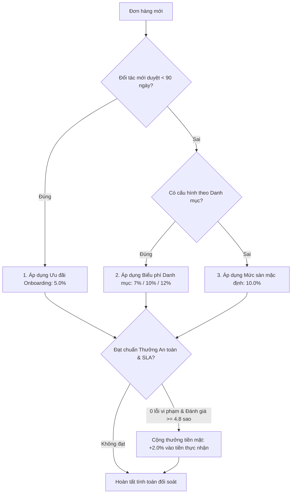

# HỆ THỐNG HOA HỒNG BIẾN THIÊN (DYNAMIC COMMISSION) — DANASEA


---
## 1. Cơ Chế Tính Phí Nhiều Tầng (Cascading Resolution)

Khi phát sinh đơn hàng, hệ thống tự động xác định mức hoa hồng theo thứ tự ưu tiên từ trên xuống:



1. **Ưu tiên 1 — Ưu đãi Đối tác mới (`ONBOARDING`):**
   - Tỷ lệ: **5.0%** trong **90 ngày đầu** kể từ lúc duyệt tài khoản.
2. **Ưu tiên 2 — Theo Danh mục Dịch vụ (`CATEGORY`):**
   - Biểu phí động chia làm 3 nhóm (7.0%, 10.0%, 12.0%).
3. **Ưu tiên 3 — Mức sàn mặc định (`GLOBAL`):**
   - Áp dụng khi không khớp quy tắc trên: **10.0%**.
4. **Chính sách Thưởng An Toàn & SLA (`SAFETY_REBATE`):**
   - Hoàn thêm tiền mặt **+2.0%** vào tiền đối tác thực nhận nếu trong kỳ: **0 khiếu nại do lỗi đối tác** và **Điểm đánh giá $\ge 4.8$ sao** (tối thiểu 5 lượt đánh giá).

---

## 2. Biểu Phí Hoa Hồng 12 Danh Mục Dịch Vụ

| Nhóm Dịch Vụ | Tỷ Lệ | Danh Mục Áp Dụng (Slug) | Màu Badge UI (Tuân thủ Purple Ban) |
| :--- | :---: | :--- | :--- |
| **Nhóm 1: Tiện ích & Thuê dụng cụ** | **7.0%** | • Thuê ván SUP (`thue-sup`)<br>• Thuê Kayak (`thue-kayak`)<br>• Thuê ván lướt sóng (`thue-van-luot-song`) | Nền xanh ngọc nhạt `#ecfdf5`<br>Chữ xanh đậm `#065f46` |
| **Nhóm 2: Thể thao biển phổ thông** | **10.0%** | • Cano lướt sóng & Dù bay (`cano-du-bay`)<br>• Mô tô nước Jetski (`mo-to-nuoc-jetski`)<br>• Phao chuối cảm giác mạnh (`truot-phao-chuoi`)<br>• Chèo SUP & Kayak (`cheo-sup-kayak`) | Nền cyan nhạt `#eef7f8`<br>Chữ cyan đậm `#0b5d6f` |
| **Nhóm 3: Tour chuyên sâu & Lặn biển** | **12.0%** | • Lặn ngắm san hô (`lan-ngam-san-ho`)<br>• Câu cá biển cano riêng (`cau-ca-bien`)<br>• Câu mực đêm (`cau-muc-dem`)<br>• Học lướt sóng (`hoc-luot-song`)<br>• Surf tour có hướng dẫn (`surf-tour-co-huong-dan`) | Nền hổ phách nhạt `#fffbeb`<br>Chữ nâu vàng `#92400e` |


```
                                  ┌───────────────────────────────┐
                                  │      YÊU CẦU ĐẶT CHỖ MỚI      │
                                  │ (vendorId, service, category) │
                                  └──────────────┬────────────────┘
                                                 │
                                                 ▼
                                  ┌───────────────────────────────┐
                                  │ Rule ONBOARDING đang Active   │
                                  │ & Vendor duyệt <= 90 ngày?    │
                                  └──────┬─────────────────┬──────┘
                                    CÓ   │                 │  KHÔNG
                  ┌──────────────────────┘                 └──────────────────────┐
                  ▼                                                               ▼
     ┌─────────────────────────┐                                    ┌───────────────────────────┐
     │ ƯU ĐÃI ONBOARDING (5%)  │                                    │ Có Rule CATEGORY Active   │
     │ (Áp dụng 90 ngày đầu)   │                                    │ khớp với category_id?     │
     │ (Priority 100)          │                                    └─────┬───────────────┬─────┘
     └─────────────────────────┘                                      CÓ  │               │ KHÔNG
                                                                ┌─────────┘               └─────────┐
                                                                ▼                                   ▼
                                                  ┌───────────────────────────┐       ┌───────────────────────────┐
                                                  │ TỶ LỆ THEO DANH MỤC       │       │ FALLBACK MẶC ĐỊNH SÀN     │
                                                  │ 7.0% - 10.0% - 12.0%      │       │ (PLATFORM_COMMISSION=10%) │
                                                  │ (Priority 50)             │       │ (Priority 0)              │
                                                  └───────────────────────────┘       └───────────────────────────┘
```

