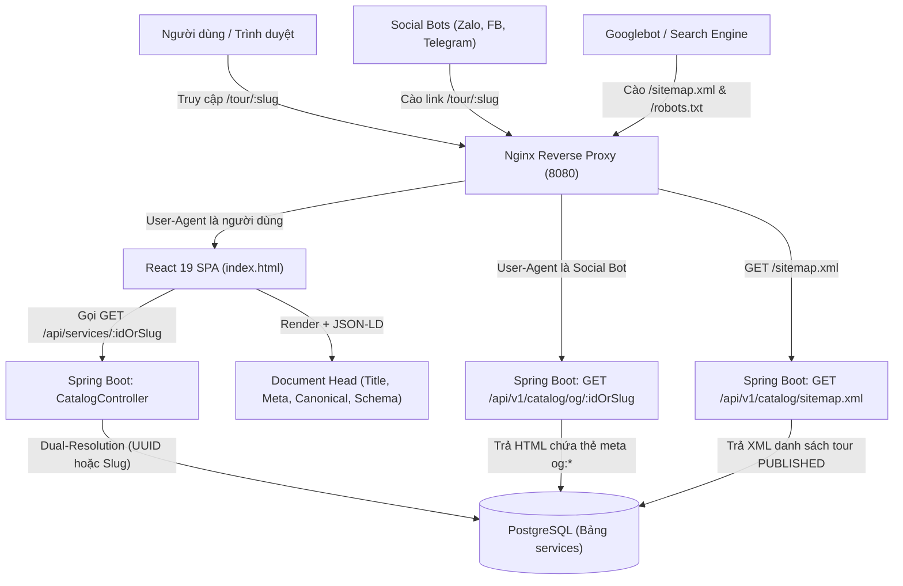

# Kế Hoạch Chi Tiết Tối Ưu SEO Toàn Diện Hệ Thống DANASEA (v2.0)

> [!IMPORTANT]
> Tài liệu này được xây dựng dựa trên kết quả kiểm toán (Audit) trực tiếp mã nguồn thực tế của dự án **DANASEA** (Frontend **React 19 + Vite**, Backend **Spring Boot 3 + PostgreSQL/Flyway**, Reverse Proxy **Nginx + Docker**). Mọi giải pháp đều đảm bảo **tương thích ngược 100%** với ứng dụng Mobile, Giỏ hàng, Đơn hàng và hệ thống Integration Test hiện có.

---

## 1. Tổng Quan Hiện Trạng & Mục Tiêu Chiến Lược

### 1.1. Các vấn đề hiện tại trong Codebase
1. **Hạn chế của Client-Side Rendering (CSR):**
   - `frontend/index.html` chỉ chứa `<div id="root"></div>` và `<title>DANASEA</title>`, thiếu hoàn toàn các thẻ `meta description`, `canonical`, Open Graph (`og:*`), Twitter Card và đang khai báo `<html lang="en">` thay vì `vi`.
   - Khi chia sẻ link tour lên **Zalo, Facebook, Messenger, Telegram**, bot mạng xã hội không thực thi JavaScript nên không hiển thị được ảnh bìa, tên tour hay giá vé.
2. **Định dạng URL chưa chuẩn SEO & Bị phân mảnh:**
   - Route chi tiết đang dùng ID dạng UUID (`/tour/:id` và `/experience/:id`) trong `frontend/src/App.tsx`.
   - Việc tồn tại song song `/tour/:id` và `/experience/:id` cho cùng một trang `ExperienceDetail` gây lỗi **Duplicate Content** (trùng lặp nội dung), làm phân tán điểm xếp hạng của Google.
3. **Thiếu hụt dữ liệu `slug` ở Backend & Database:**
   - Bảng `services` và `ServiceJpaEntity.java` đã có cột `slug`, nhưng `CreateServiceUseCase.java` và `UpdateServiceUseCase.java` chưa tự động sinh `slug`. Dữ liệu hiện có trong DB đang để `slug = null`.
   - Các DTO trả về (`ServiceSummaryResponse.java`, `ServiceDetailResponse.java`) chưa có trường `slug`.
4. **Thiếu Technical SEO & Structured Data:**
   - Chưa có `robots.txt` và `sitemap.xml` động.
   - Chưa có dữ liệu có cấu trúc **Schema.org (JSON-LD)** cho `TouristTrip`, `Product`, `AggregateRating`, `BreadcrumbList`, `Organization`.

### 1.2. Mục tiêu đầu ra
- **URL Pure Slug chuẩn SEO:** Đưa đường dẫn tour về dạng `/tour/lan-bien-ngam-san-ho-ban-dao-son-tra` (không kèm ID phía sau), tự động chuyển hướng (Canonical Redirect) từ `/experience/*` và `/tour/<uuid>` về `/tour/<slug>`.
- **Hiển thị chia sẻ chuyên nghiệp 2 cấp bậc (Hierarchical Open Graph):**
  - *Cấp Thương hiệu (Trang chủ, Khám phá, Tìm kiếm):* Hiển thị Brand Card chuẩn của DANASEA.
  - *Cấp Chi tiết Tour (`/tour/:slug`):* Hiển thị Rich Preview Card gồm ảnh thực tế của tour, tên tour, mức giá, điểm đánh giá sao và thương hiệu DANASEA trên Zalo/Facebook.
- **Technical SEO & Rich Snippets đầy đủ:** Có `robots.txt`, `sitemap.xml` tự động cập nhật từ Database, JSON-LD Schema chuẩn Google Rich Results và tối ưu bộ nhớ đệm `Cache-Control` trên Nginx.

---

## 2. Kiến Trúc Tổng Thể Giải Pháp



---

## 3. Phân Rã Chi Tiết Các Giai Đoạn Triển Khai

### Phase 1: Database & Backend Spring Boot (Pure Slug & SEO Endpoints)

#### 1.1. Tiện ích sinh Slug tiếng Việt (`SlugUtils.java`)
- **Vị trí:** `backend/src/main/java/com/danasea/backend/shared/utils/SlugUtils.java`
- **Chức năng:**
  - Chuyển đổi chuỗi tiếng Việt có dấu sang không dấu (bao gồm xử lý ký tự `đ/Đ` ➔ `d`), chuyển thành chữ thường, thay khoảng trắng và ký tự đặc biệt bằng dấu gạch ngang `-`, cắt bỏ gạch ngang thừa ở hai đầu.
  - Ví dụ: `"Tour Lặn Biển Ngắm San Hô - Cù Lao Chàm"` ➔ `"tour-lan-bien-ngam-san-ho-cu-lao-cham"`.
  - Hỗ trợ sinh slug duy nhất (Unique Slug Resolution): Nếu `slug` đã tồn tại trong bảng `services`, tự động nối hậu tố `-2`, `-3`,... cho đến khi duy nhất.

#### 1.2. Flyway Migration (`V44__backfill_and_index_service_slugs.sql`)
- **Vị trí:** `backend/src/main/resources/db/migration/V44__backfill_and_index_service_slugs.sql`
- **Nội dung:**
  - Viết hàm SQL chuyển đổi tiếng Việt không dấu để backfill (điền dữ liệu) cột `slug` cho toàn bộ các bản ghi trong bảng `services` đang có `slug IS NULL` hoặc rỗng.
  - Xử lý chống trùng lặp `slug` nếu có các dịch vụ trùng tên bằng `ROW_NUMBER() OVER (PARTITION BY base_slug ORDER BY created_at, id)`.
  - Tạo Unique Index `uk_services_slug ON services(slug) WHERE slug IS NOT NULL`.
  - Đồng bộ cập nhật trường `slug` trong file dữ liệu mẫu `dataBase_demo/data/services.json` để môi trường demo luôn nhất quán.

#### 1.3. Tự động gán `slug` khi Tạo mới / Cập nhật dịch vụ
- **Files tác động:**
  - `JpaServiceRepository.java`: Thêm `Optional<ServiceJpaEntity> findBySlugAndStatus(String slug, ServiceStatus status)` và `Optional<ServiceJpaEntity> findBySlug(String slug)`.
  - `ServiceRepositoryPort.java` & `ServiceRepositoryAdapter.java`: Bổ sung `findPublishedBySlug(String slug)` và `existsBySlug(String slug)`.
  - `CreateServiceUseCase.java`: Tự động sinh `slug` duy nhất từ `cmd.name()` khi tạo dịch vụ.
  - `UpdateServiceUseCase.java`: Nếu dịch vụ chưa có `slug` hoặc khi đổi `name`, tự động cập nhật/đảm bảo `slug` hợp lệ.

#### 1.4. Nâng cấp DTO & Dual-Resolution API (`id` hoặc `slug`)
- **Files tác động:**
  - `ServiceSummaryResult.java` & `ServiceSummaryResponse.java`: Thêm trường `private String slug;`.
  - `ServiceDetailResult.java` & `ServiceDetailResponse.java`: Thêm trường `private String slug;`.
  - `GetPublicServiceDetailUseCase.java`: Bổ sung phương thức `executeByIdOrSlug(String idOrSlug, UUID userId, String sessionId)`:
    - Kiểm tra nếu `idOrSlug` khớp định dạng UUID ➔ gọi `findPublishedById(UUID.fromString(idOrSlug))`.
    - Ngược lại ➔ gọi `findPublishedBySlug(idOrSlug)`.
  - `CatalogController.java`:
    - Đổi `@GetMapping("/{id}")` thành `@GetMapping("/{idOrSlug}")` nhận `@PathVariable("idOrSlug") String idOrSlug`.

> [!TIP]
> Cơ chế **Dual-Resolution** này giúp toàn bộ App Mobile (`mobile/`, `vendor_mobile/`), Giỏ hàng (`Cart.tsx`), Đơn hàng (`Orders.tsx`) và các bài Integration Test cũ truyền `UUID` vẫn chạy đúng 100%, đồng thời Web truyền `slug` cũng hoạt động mượt mà trên cùng một endpoint.

#### 1.5. Endpoint Dynamic `sitemap.xml` & Social Open Graph Preview
- **Vị trí:** Bổ sung trong `CatalogController.java` (map dưới `/api/v1/catalog` để tận dụng quyền `.permitAll()` sẵn có trong `SecurityConfig.java`):
  1. `GET /api/v1/catalog/sitemap.xml` (`produces = MediaType.APPLICATION_XML_VALUE`):
     - Sinh XML chuẩn giao thức `http://www.sitemaps.org/schemas/sitemap/0.9`.
     - Bao gồm các trang tĩnh (`/`, `/explore`, `/search`), các danh mục (`/search?category=...`) và toàn bộ tour đang `PUBLISHED` (`/tour/{slug}`) kèm `<lastmod>`, `<changefreq>daily</changefreq>`, `<priority>0.9</priority>`.
  2. `GET /api/v1/catalog/og/{idOrSlug}` (`produces = MediaType.TEXT_HTML_VALUE`):
     - Khi bot mạng xã hội (Zalo, Facebook, Twitter, Telegram) truy cập `/tour/:slug`, endpoint này trả về trang HTML nhẹ chứa đầy đủ:
       - `<title>[Tên Tour] | DANASEA - Trải nghiệm biển Đà Nẵng</title>`
       - `<meta property="og:title" ... />`, `<meta property="og:description" ... />` (kèm giá tour & đánh giá sao), `<meta property="og:image" ... />` (ảnh chính của tour), `<meta property="og:url" ... />`, `<meta property="og:type" content="product" />`.
       - Thẻ JSON-LD Schema.org cho dịch vụ.

---

### Phase 2: Cấu Hình Nginx & Technical SEO (`robots.txt`, Caching, Bot Routing)

#### 2.1. Khởi tạo `frontend/public/robots.txt`
- **Vị trí:** `frontend/public/robots.txt`
- **Cấu hình:**
  ```txt
  User-agent: *
  Allow: /
  Allow: /explore
  Allow: /search
  Allow: /tour/

  Disallow: /admin/
  Disallow: /vendor/
  Disallow: /profile/
  Disallow: /cart
  Disallow: /checkout
  Disallow: /payment/
  Disallow: /auth
  Disallow: /api/

  Sitemap: https://danasea.vn/sitemap.xml
  ```

#### 2.2. Nâng cấp `frontend/nginx.conf` và `frontend/nginx.prod.conf`
- **Files tác động:** `frontend/nginx.conf` và `frontend/nginx.prod.conf`
- **Các cải tiến:**
  1. **Proxy Sitemap:**
     ```nginx
     location = /sitemap.xml {
         proxy_pass http://backend:8080/api/v1/catalog/sitemap.xml;
         proxy_set_header Host $host;
         proxy_set_header X-Forwarded-Proto $scheme;
     }
     ```
  2. **Nhận diện Bot Mạng Xã Hội cho `/tour/*` và `/experience/*`:**
     - Kiểm tra `$http_user_agent ~* "(facebookexternalhit|Facebot|Twitterbot|Zalo|ZaloPC|TelegramBot|LinkedInBot|Slackbot|WhatsApp|Discordbot)"`.
     - Nếu là Social Bot truy cập `/tour/<slug>`, Nginx rewrite nội bộ sang `http://backend:8080/api/v1/catalog/og/<slug>` để trả về thẻ Open Graph của đúng tour đó.
     - Nếu là người dùng bình thường, Nginx trả về `index.html` của React SPA như cũ.
  3. **Tối ưu Core Web Vitals (Nén Gzip & Cache-Control):**
     - Bật `gzip on;` cho `text/css`, `application/javascript`, `application/json`, `image/svg+xml`.
     - Đặt `Cache-Control: public, max-age=31536000, immutable` cho các file tĩnh có hash trong `/assets/`.

---

### Phase 3: Frontend React 19 SEO Architecture & Pure Slug Routing

#### 3.1. Chuẩn hóa `frontend/index.html` (Brand Level Metadata)
- Đổi `<html lang="en">` thành `<html lang="vi">`.
- Bổ sung bộ thẻ Meta & Open Graph mặc định mang nhận diện thương hiệu **DANASEA**:
  - `<title>DANASEA - Nền tảng Đặt Tour & Trải Nghiệm Biển Đà Nẵng Hàng Đầu</title>`
  - `<meta name="description" content="Khám phá và đặt vé các hoạt động thể thao biển, lặn ngắm san hô, chèo SUP, cano dù bay tại Đà Nẵng cùng DANASEA. Giá minh bạch, cảnh báo thời tiết AI và bảo hiểm an toàn." />`
  - Đầy đủ `og:site_name`, `og:type`, `og:title`, `og:description`, `og:image`, `twitter:card="summary_large_image"`.
  - Nhúng Schema JSON-LD cấp hệ thống (`Organization` & `WebSite` kèm `SearchAction`).

#### 3.2. Xây dựng Component `SEOHead.tsx`
- **Vị trí:** `frontend/src/components/common/SEOHead.tsx`
- **Chức năng:**
  - Cập nhật linh hoạt `document.title`, `document.documentElement.lang` (`vi` / `en` theo `useLanguageStore`), các thẻ `<meta name="description">`, `<meta name="robots">` (`index, follow` cho trang khách hàng; `noindex, nofollow` cho trang nội bộ), `<link rel="canonical">`, các thẻ `og:*` và `twitter:*`.
  - Hỗ trợ truyền mảng `jsonLd` (Structured Data Schema.org) để tự động render thẻ `<script type="application/ld+json">` sạch sẽ vào `<head>`.

#### 3.3. Tích hợp `<SEOHead>` và Schema.org vào các trang trọng điểm
1. **Trang chủ (`Home/index.tsx`):**
   - Title & Description chuẩn thương hiệu theo ngôn ngữ Việt/Anh.
   - Schema `WebSite` + `Organization` + `ItemList` các danh mục trải nghiệm biển nổi bật.
2. **Trang Khám phá (`Explore/index.tsx`) & Tìm kiếm (`Search/index.tsx`):**
   - Dynamic Title theo bộ lọc danh mục hoặc từ khóa tìm kiếm (ví dụ: `"Khám phá Lặn ngắm san hô tại Đà Nẵng | DANASEA"`).
   - Canonical URL chuẩn hóa để tránh trùng lặp query params rác.
3. **Trang Chi tiết Tour (`ExperienceDetail/index.tsx`):**
   - Dynamic Title: `${service.name} - Đặt vé trải nghiệm | DANASEA`.
   - Dynamic Description: Tóm tắt 155 ký tự đầu của mô tả tour + mức giá + địa điểm.
   - Open Graph Image: Lấy ảnh đầu tiên trong `service.imageUrls`.
   - **Schema.org JSON-LD kép (`Product` + `TouristTrip` + `BreadcrumbList`):**
     - Khai báo `name`, `description`, `image`, `offers` (`price`, `priceCurrency: "VND"`, `availability: "https://schema.org/InStock"`), `aggregateRating` (`ratingValue`, `reviewCount`), `provider` (`businessName`).

#### 3.4. Chuẩn hóa Pure Slug `/tour/:slug` & Ngăn chặn lỗi UUID
- **Cập nhật `frontend/src/types/service.ts` và `frontend/src/mockData.ts`:**
  - Thêm trường `slug?: string` vào `ServiceSummaryDto` và `ServiceDetailDto`.
  - Bổ sung `slug` chuẩn cho toàn bộ phần tử trong `FEATURED_SERVICES` ở `mockData.ts`.
- **Cập nhật `ExperienceDetail/index.tsx`:**
  - Đọc tham số `id` (hoặc `slug`) từ `useParams()`.
  - Gọi `serviceCatalogService.getServiceDetail(param)` (hỗ trợ cả slug lẫn UUID, kể cả fallback mock data theo `s.slug === param || s.id === param`).
  - **Auto-Canonical URL Normalization:** Ngay khi tải xong dữ liệu `service`, nếu đường dẫn hiện tại đang là `/experience/...` hoặc đang chứa UUID (`/tour/<uuid>`) mà `service.slug` tồn tại ➔ gọi `navigate(`/tour/${service.slug}`, { replace: true })` để chuyển URL sang dạng `/tour/ten-tour` sạch sẽ.
  - **Bảo toàn UUID cho API phụ:** Mọi lời gọi `reviewService.getServiceReviews(service.id)`, `addItem({ serviceId: service.id, ... })`, `toggleWishlist(service.id)` đều lấy từ **`service.id` (UUID)** thay vì lấy từ `useParams()`, triệt tiêu 100% lỗi `400 Bad Request`.
- **Cập nhật toàn bộ Link điều hướng trên giao diện Khách hàng:**
  - Tại `Home/index.tsx`, `FlashSaleSection.tsx`, `CategoryExperienceCarousel.tsx`, `Search/index.tsx`, `Explore/index.tsx`, `Wishlist.tsx`, `Cart.tsx`:
  - Đồng bộ sử dụng helper `getTourUrl(service)` trả về `/tour/${service.slug || service.id}` (thống nhất về `/tour/...` thay vì chia đôi `/experience/...` và `/tour/...`).

---

## 4. Kế Hoạch Kiểm Thử & Nghiệm Thu (Verification Checklist)

| STT | Hạng mục kiểm tra | Công cụ / Lệnh kiểm chứng | Tiêu chí đạt (Pass Criteria) |
| :-: | :--- | :--- | :--- |
| 1 | **Build & Type-check Frontend** | `cd frontend && npm run build && npm run lint` | Biên dịch TypeScript & Vite thành công với 0 lỗi, 0 cảnh báo. |
| 2 | **Unit & Integration Test Backend** | `cd backend && ./mvnw test -Dtest=*Service*Test,*Catalog*Test` | Toàn bộ test của module Service & Catalog vượt qua 100%. |
| 3 | **Kiểm tra Dual-Resolution (`/tour/:slug` & `/tour/:uuid`)** | Truy cập cả `/tour/lan-ngam-san-ho-...` và `/tour/<uuid>` hoặc `/experience/<uuid>` | Cả 2 đều tải đúng trang chi tiết, URL tự động chuẩn hóa về `/tour/<slug>`, tính năng Review/Cart/Wishlist hoạt động bình thường. |
| 4 | **Kiểm tra Technical SEO (`robots.txt` & `sitemap.xml`)** | Kiểm tra `/robots.txt` và `GET /api/v1/catalog/sitemap.xml` | Trả về đúng định dạng chuẩn, liệt kê các URL `/tour/<slug>` hợp lệ. |
| 5 | **Kiểm tra Social Open Graph & JSON-LD** | Kiểm tra `GET /api/v1/catalog/og/<slug>` và thẻ `<script type="application/ld+json">` trên DOM | Hiển thị đầy đủ `og:title`, `og:description`, `og:image` và Schema `Product`/`TouristTrip` hợp lệ. |
